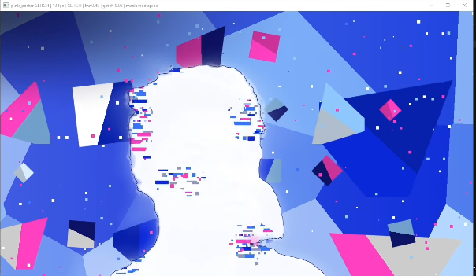
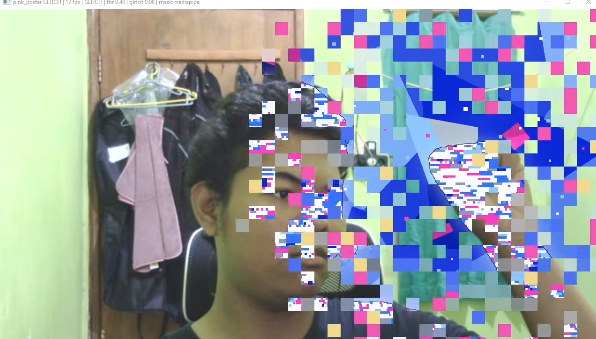

# NightGlitch

Real-time, GPU-accelerated **glitch poster** effect for your webcam.

NightGlitch cuts you out of the camera feed with MediaPipe, paints you as a near-white silhouette with a thin navy contour and clustered glitch blocks, and drops you into a blue low-poly world of floating shards, glowing isometric cubes, stars, a wireframe net and confetti. Raise an open hand and close it into a fist to trigger a pixel-mosaic transition between the raw camera and the effect.

Everything visual is drawn in a single GLSL fragment shader, so it runs smoothly on most GPUs with OpenGL 3.3.

<p align="center">
  
  
</p>

<p align="center"><sub>Left: GLITCH look &nbsp;·&nbsp; Right: mosaic transition between camera and effect</sub></p>

## Features

- **GLITCH look**: white silhouette, navy contour, soft glow, glitch blocks that re-roll ~8 times per second and cluster in noise patches (face, chest, shoulders).
- **Low-poly background**: voronoi facets, two layers of drifting shards, spiky stars, glowing isometric cubes, wireframe net, confetti, navy vignette.
- **Gesture transition**: open hand, then fist, triggers a mosaic wave that starts at your palm.
- **Extra looks**: POSTER (halftone), CITY and DOTS, with animated text cards.
- **Live tuning**: adjust silhouette brightness and glitch density from the keyboard.
- **Recording**: save the output to MP4 with one key.
- **Test mode**: runs without MediaPipe using an animated dummy mask.

## Requirements

- Python 3.9+
- A webcam
- A GPU / driver with **OpenGL 3.3** support

## Installation

```bash
git clone https://github.com/<your-username>/nightglitch.git
cd nightglitch

python -m venv .venv
# Windows: .venv\Scripts\activate
source .venv/bin/activate

pip install -r requirements.txt
```

> NightGlitch uses MediaPipe's `mp.solutions` API (Hands + Selfie Segmentation). If your installed MediaPipe version no longer ships it, install an older release or run with `--test`.

## Usage

```bash
python nightglitch.py                       # default: 1280px window, GLITCH look
python nightglitch.py --width 960 --mp-skip 3   # lighter on slow machines
python nightglitch.py --test                # no MediaPipe, dummy mask
python nightglitch.py --auto                # cycle through all looks
python nightglitch.py --cam 1               # use a different camera
```

### Options

| Option | Default | Description |
| --- | --- | --- |
| `--cam N` | `0` | Camera index |
| `--width N` | `1280` | Window width (16:9 aspect ratio) |
| `--mp-skip N` | `2` | Run MediaPipe every N frames (higher = faster, laggier mask) |
| `--test` | off | Use the dummy mask instead of MediaPipe |
| `--auto` | off | Switch looks automatically every 14 seconds |

### Keys

| Key | Action |
| --- | --- |
| `Q` / `ESC` | Quit |
| `SPACE` | Trigger the mosaic transition from the screen centre |
| `L` | Next look (POSTER / CITY / DOTS / GLITCH) |
| `M` | Toggle MediaPipe / test mask |
| `[` `]` | Silhouette threshold (darker / lighter) |
| `,` `.` | Fewer / more glitch blocks |
| `R` | Start / stop MP4 recording (`nightglitch_YYYYMMDD_HHMMSS.mp4`) |
| `F` | Toggle fullscreen |

### Gesture

Show an **open hand**, then make a **fist**. The mosaic transition fires once from the palm position and switches between the camera feed and the effect. Open your hand again to re-arm it.

## How it works

```
Webcam ──► Worker thread ──► MediaPipe (selfie segmentation + hands)
                │                         │
                ▼                         ▼
          camera texture            mask texture + gestures
                └──────────────┬──────────┘
                               ▼
                  Fragment shader (moderngl / GLFW)
        silhouette · glitch · low-poly background · mosaic wave
```

- Capture and vision run in a background thread so rendering stays at your monitor's refresh rate.
- The segmentation mask is smoothed over time to reduce flicker.
- The GLITCH look, its background and the transition are all procedural; no image assets are needed.

## Troubleshooting

- **Window fails to open**: your GPU or driver does not expose OpenGL 3.3 core. Update drivers.
- **Low FPS**: use `--width 960` and `--mp-skip 3`.
- **Black or dark image**: try another camera index with `--cam 1`.
- **MediaPipe import errors**: run with `--test` to confirm the renderer works, then fix the MediaPipe install.

## Project structure

```
nightglitch/
├── nightglitch.py
├── requirements.txt
├── docs/
│   ├── glitch.png
│   └── transition.png
└── README.md
```

## License

Choose a license for your repository (for example MIT) and add a `LICENSE` file.
